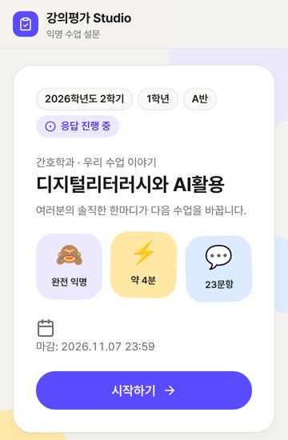
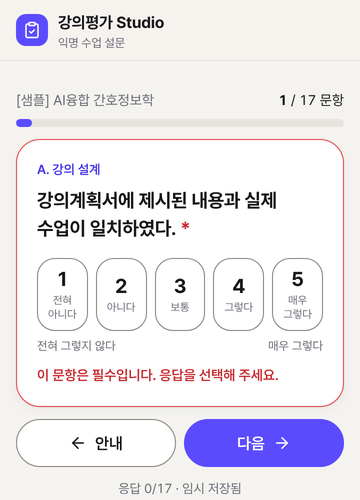
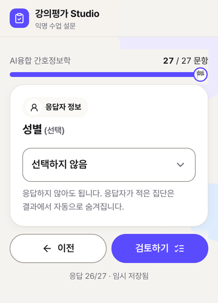
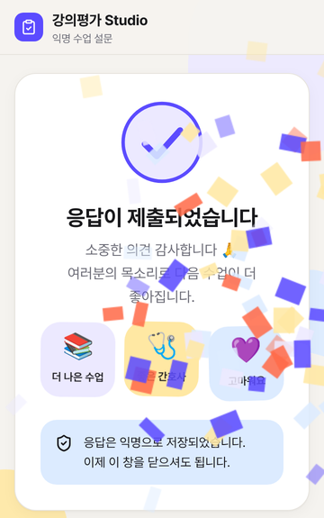
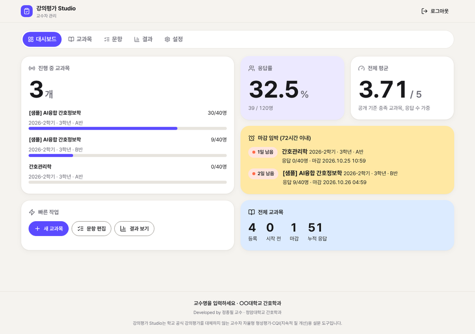
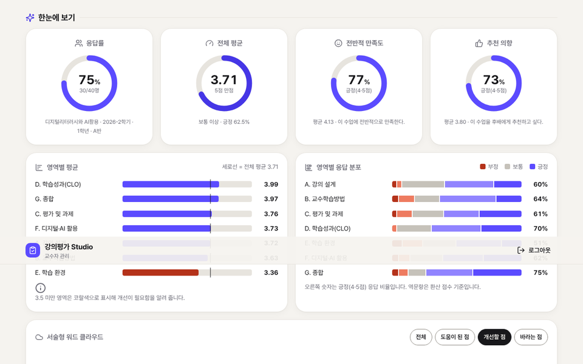
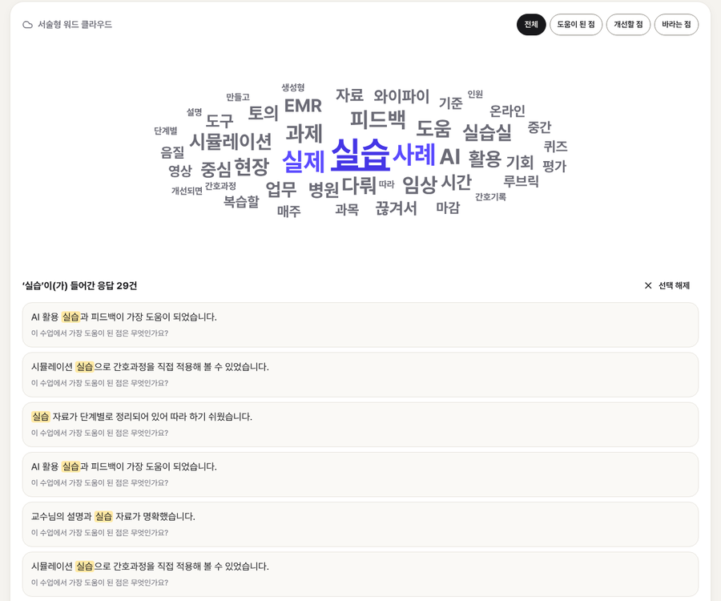
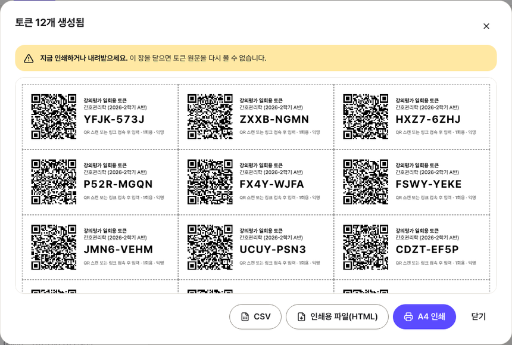

# 강의평가 Studio

간호학과 교수가 학기말에 **교과목별 강의평가를 직접 운영**하는 웹 앱입니다.
Google 스프레드시트 하나와 Apps Script만으로 동작하며 외부 서버가 필요 없습니다.

> 🧪 **바로 체험하기: https://jp5678.github.io/Course-Evaluation/** — 설치 없이 브라우저에서 학생 응답 화면과 교수 대시보드를 체험할 수 있습니다(관리자 PIN `123456`, 데이터는 그 브라우저에만 저장).

> ⚠️ **이 도구는 학교 공식 강의평가를 대체하지 않습니다.** 교수자가 수업 개선(CQI)을 위해 자율적으로 운영하는 형성평가용 설문 도구입니다.

| 시작 화면 | 이모지 리커트 | 드롭다운 문항(예시) | 제출 완료 |
|---|---|---|---|
|  |  |  |  |

| 교수 대시보드(교과목 한눈에) | 결과 한눈에 보기 |
|---|---|
|  |  |



---

## 주요 기능

**학생 화면 — 다이나믹 디자인**
- 로그인 없이 응답합니다. 학번·이름·이메일·IP·기기 정보를 수집하지 않으며, 제출 **날짜만** 기록합니다.
- 휴대폰에서는 한 화면에 한 문항, PC에서는 영역 단위로 표시됩니다.
- 이모지 리커트 칩(😞🙁😐🙂😄, 48px 이상), 키보드 1~5 입력, 문항 슬라이드 전환, 진행 바 마커, 절반·80% 지점의 응원 메시지, 떠다니는 배경 도형, 체크 애니메이션과 confetti를 넣었습니다. 기기에서 「동작 줄이기」를 켜면 모두 멈춥니다.
- 진행 바와 임시 저장을 지원합니다.
- 제출 전에 검토 화면을 거치며, 제출하면 감사 화면이 나타납니다.
- 기간 전 접속·마감·토큰 재사용 시 각각 안내 화면을 보여 줍니다.

**교수 화면**
- 대시보드: 응답 수·전체 평균·긍정 응답률을 보여 줍니다. 「교과목 한눈에」 카드에서는 교과목별 응답 수, 평균, 영역 막대를 보여 주고, 마감 임박 교과목을 알려 줍니다. (수강인원을 입력하지 않으므로 응답률(%)은 표시하지 않습니다.)
- 교과목 관리: **학과·학년(1~4)·학기(1·2)·수업 방식(대면/비대면/혼합)·교과목 유형을 드롭다운으로** 설정합니다(반·수강인원은 입력하지 않음). 이전 학기 복제, 응답 기간 설정, 링크·QR 생성, 수업 화면용 QR 크게 띄우기를 지원합니다.
- 일회용 토큰: N개를 생성하고 A4 절취형 인쇄 시트로 출력합니다. 시트의 QR을 찍으면 토큰이 자동 입력됩니다.
- 문항 편집기: 기본 문항 불러오기, 드래그(또는 ↑↓ 버튼)로 순서 변경, CLO 일괄 입력을 지원합니다. 문항 유형은 리커트·단일 선택·복수 선택·**드롭다운**·서술형이며, 「비대면·혼합 수업에서만」 표시 옵션이 있습니다.
- **결과 한눈에 보기**: 응답 수·전체 평균·전반적 만족도·추천 의향을 보여 줍니다. 영역별 평균은 전체 평균 기준선과 함께 정렬한 막대로, 영역별 부정·보통·긍정 분포는 막대로 보여 줍니다. 교수가 드롭다운 문항을 직접 추가하면 그 문항의 집단별 비교도 제공합니다(소규모 집단은 자동 숨김).
- **서술형 워드 클라우드**: 전체 또는 문항별로 볼 수 있습니다. 단어를 누르면 그 단어가 들어간 응답만 강조해서 모아 보여 줍니다.
- 상세 분석: 문항별 평균·표준편차·분포, 영역 레이더 차트, 학기 간 비교(교과목명 기준, 다른 학기끼리), 서술형 응답(무작위 순서)을 제공합니다. 같은 교과목이 같은 학기에 여러 개(이전 버전의 분반 자료)일 때만 분반 간 비교가 나타납니다.
- 내보내기: 원자료 PDF, CQI 요약표 PDF, 서술형 텍스트(AI 요약용, TXT·PDF)를 내려받을 수 있습니다.
- **응답이 최소 공개 수(기본 5명) 미만이면 결과를 잠급니다.** 결과공개일을 지정하면 그 이전에도 잠깁니다(성적 처리 전 열람 방지).

### 기본 문항 은행 (5점 리커트, 교수가 수정 가능)

| 영역 | 문항 수 | 내용 |
|---|---|---|
| A. 강의 설계 | 2 | 강의계획서와 수업 일치, 수업 목표의 명확성 |
| B. 교수학습방법 | 4 | 설명의 이해 용이성, 수업 자료의 유용성, 질문·참여 기회, 다양한 교수학습방법(토의·사례·시뮬레이션·플립러닝·스마트교수법·AI활용) |
| C. 평가 및 과제 | 4 | 평가 기준 사전 공지, 평가의 공정성, 과제의 양·난이도, 피드백의 적시성 |
| D. 학습성과(CLO) | 교과목별(예시 5) | "나는 ~할 수 있게 되었다" 자기평가(CLO 일괄 입력). 예시 교과목 2개는 CLO 5개씩 |
| E. 학습 환경 | 3 | 이론 강의실 환경, 실습실 시설·기자재, 유무선 인터넷(Wi-Fi) |
| F. 디지털·AI 활용 | 5 | 학습에 도움, 간호실무 활용 가능성, 사용 방법 안내, AI 정보의 비판적 검토, 윤리·저작권·개인정보(환자정보) 보호 |
| G. 종합 | 2 | 전반적 만족도, 후배 추천 의향 |
| H. 온라인(비대면) 강의 | 4 | 영상·음성 품질, LMS 접속·사용, 온라인 상호작용, 자료·공지의 적시성 — **비대면·혼합 교과목에만 표시** |
| 서술형 | 3 | 가장 도움이 된 점, 교수학습방법·평가·과제의 개선점, 다음 학기에 바라는 점 |

> ✅ **모든 문항은 필수 응답**으로 설정되어 있습니다(서술형 포함). 문항 편집기에서 문항별로 「필수」를 해제할 수 있습니다. 서술형을 필수로 하면 "없음" 같은 짧은 답이 늘 수 있습니다. 응답자 정보(성별) 문항은 익명성 보호를 위해 기본 문항에서 뺐습니다.

> ⏱ **문항 수에 대한 솔직한 안내**: 요청하신 문항을 모두 넣어 대면 교과목은 CLO 5개를 포함해 28문항, 혼합·비대면 교과목은 32문항이며 예상 시간은 약 5분입니다. 처음 목표였던 "3분 이내"를 넘습니다. 응답률이 걱정되면 [문항] 탭에서 교과목에 맞지 않는 문항(예: 실습이 없는 이론 교과목의 실습실 문항)을 삭제하세요. 편집기에 예상 시간이 표시됩니다.

### 이번 학기 예시(setup 시 자동 생성)

| 교과목 | 학과 | 학년·학기 | 수업 방식 | 문항 |
|---|---|---|---|---|
| 디지털리터러시와 AI활용 | 간호학과 | 1학년 · 1학기 | 대면 | 22 |
| AI융합 간호정보학 | 간호학과 | 3학년 · 2학기 | 혼합 | 26 |

- 학기는 **디지털리터러시와 AI활용 = 1학기**, **AI융합 간호정보학 = 2학기**입니다(학년도는 setup 실행 날짜 기준). 학기는 1학기·2학기만 선택할 수 있습니다.
- **수업 방식, 교과목 유형, 응답 기간(오늘부터 2주)은 예시값입니다.** [교과목 ▸ 편집]에서 실제 값으로 바꾸세요.
- 화면 하단에는 교수명·소속을 표시하지 않고, 개발자 표기("Developed by 정종필 교수 · 청암대학교 간호학과")와 형성평가 안내만 표시합니다.

---

## 정식 설치 — 설치 파일 1개로 (권장 · 약 10분)

템플릿 시트가 없어도, 파일 하나만 붙여 넣으면 바로 정식 버전을 쓸 수 있습니다.

1. Google 스프레드시트를 새로 만듭니다(예: `강의평가 Studio`).
2. **[확장 프로그램] ▸ [Apps Script]** 를 엽니다. 왼쪽 `Code.gs`의 내용을 모두 지우고 설치 파일 **`Code.gs`** 전체를 붙여 넣은 뒤 저장(Ctrl+S)합니다.
   - **내려받기:** [dist/Code.gs](dist/Code.gs) 파일 화면 오른쪽 위의 **⤓ (Download raw file)** 버튼을 누르거나, [체험판 첫 화면](https://jp5678.github.io/Course-Evaluation/)의 **[Code.gs 내려받기]** 버튼을 누르세요. 내려받은 파일을 메모장 등으로 열어 전체 선택(Ctrl+A) → 복사합니다.
   - `dist/Code.gs`와 `dist/CourseEvaluationStudio.gs`는 내용이 같은 파일입니다(이름만 다름).
3. (권장) 편집기 왼쪽 **⚙ 프로젝트 설정 ▸ 시간대**를 `(GMT+09:00) 서울`로 바꿉니다. 날짜 계산은 설치 파일이 한국 시간으로 고정하지만, 샘플 데이터의 시각까지 맞추려면 이 설정이 필요합니다.
4. 위쪽 함수 선택 상자에서 **`setup`** 을 고르고 **[실행]** → 권한 승인(아래 3단계와 같음)을 합니다.
5. **[배포] ▸ [새 배포] ▸ 웹 앱**으로 배포합니다(실행: 나 / 액세스: 모든 사용자). 아래 4단계와 같습니다.
6. 스프레드시트를 새로고침하고 메뉴 **[강의평가 Studio] ▸ ② 관리자 PIN 설정·재설정**으로 PIN을 정한 뒤, `웹앱URL?page=admin`으로 로그인합니다.

> 설치 파일은 원본 소스(`Code.gs`·`Setup.gs`·HTML 4개)를 하나로 묶은 것으로, 원본과 같은 화면을 렌더링하는지 자동 테스트로 확인합니다. 혹시 붙여 넣기가 되지 않으면 아래 「템플릿 제작자용」의 7개 파일 방식으로 설치하세요.
> 새 버전으로 업데이트할 때는 같은 방법으로 `Code.gs` 내용을 새 설치 파일로 바꾸고, **`setup`을 한 번 실행**(이전 버전 시트 자동 업그레이드·새 권한 승인)한 뒤 **[배포] ▸ [배포 관리] ▸ ✏️ ▸ 새 버전**으로 다시 배포하면 됩니다. 시트의 데이터는 그대로 유지되며, 응답이 이미 들어온 교과목의 문항 구성은 바뀌지 않습니다.

## 설치 가이드 (교수용 · 약 15분)

미리 준비할 것: Google 계정 하나(개인 Gmail 권장. 아래 [문제 해결](#문제-해결) 참고)

### 1단계. 템플릿 사본 만들기 (1분)

1. 배포자에게 받은 **템플릿 링크**를 엽니다. 링크 끝이 `/copy`이면 사본 만들기 창이 바로 열립니다.
2. **[사본 만들기]** 를 누릅니다. 내 Google Drive에 *강의평가 Studio의 사본*이 생깁니다.

> 📷 *스크린샷 자리: 「문서 사본 만들기」 대화상자*

사본 안에는 프로그램(Apps Script)도 함께 복사됩니다. 이 사본은 **나만의 독립된 강의평가 시스템**이 됩니다.

### 2단계. 초기 설정 실행 (2분)

1. 사본 스프레드시트를 열고 5~10초 기다리면 상단 메뉴에 **[강의평가 Studio]** 가 나타납니다.
2. **[강의평가 Studio] ▸ ① 초기 설정 실행** 을 누릅니다.

> 📷 *스크린샷 자리: 상단 메뉴 [강의평가 Studio] 펼친 모습*

초기 설정이 끝나면 다음이 자동으로 만들어집니다.

| 탭 | 내용 |
|---|---|
| Settings | 교수명, 소속, 최소 공개 응답 수(5), PIN 해시 등 |
| Courses | 이번 학기 예시 교과목 2개(디지털리터러시와 AI활용, AI융합 간호정보학) |
| Items | 공통 기본 문항 24개(온라인 전용 4개 포함), 예시 교과목 문항 22·26개(CLO 2개씩 포함) |
| Tokens | 일회용 토큰 해시(원문 토큰은 저장하지 않음) |
| Responses | 응답(날짜만 기록, 시각 미저장) |

Courses·Items·Tokens·Responses 탭에는 직접 편집하면 경고가 뜨도록 보호가 걸려 있습니다(교과목·문항은 관리자 화면에서 수정). 학기 시작 전에는 메뉴 **응답 시트 빈 열 정리**로 데이터가 없는 문항 열을 정리할 수 있습니다.

### 3단계. 권한 승인 (2분)

처음 실행하면 Google이 권한을 묻습니다. 개인이 만든 스크립트에는 항상 나타나는 정상 절차입니다.

1. **[계속]** → 내 계정을 선택합니다.
2. 「Google에서 확인하지 않은 앱」 화면이 나오면 **[고급] ▸ [강의평가 Studio(으)로 이동(안전하지 않음)]** 을 누릅니다.
3. 요청 권한을 확인하고 **[허용]** 을 누릅니다.

> 📷 *스크린샷 자리: 「Google에서 확인하지 않은 앱」 화면과 [고급] 위치*

요청하는 권한은 다음 두 가지입니다(외부 서비스 연결 권한은 v1.3.0부터 쓰지 않습니다).
- **이 스프레드시트만** 보고 편집: `@OnlyCurrentDoc` 설정으로 다른 파일에는 접근하지 않습니다.
- 스프레드시트에 메뉴·대화상자 표시

승인한 뒤 **① 초기 설정 실행**을 한 번 더 누르면 설정이 완료됩니다.

### 4단계. 웹 앱으로 배포 (5분)

1. **[확장 프로그램] ▸ [Apps Script]** 를 엽니다.
2. 오른쪽 위 **[배포] ▸ [새 배포]** 를 누릅니다.
3. 톱니바퀴(유형 선택)에서 **웹 앱**을 고릅니다.
4. 다음과 같이 설정합니다. **이 설정이 가장 중요합니다.**
   - 설명: `강의평가 Studio`
   - **다음 사용자 인증 정보로 실행: 나(내 이메일)**
   - **액세스 권한이 있는 사용자: 모든 사용자** ← 학생이 로그인 없이 응답하려면 반드시 이 값이어야 합니다.
5. **[배포]** 를 누르고 표시되는 **웹 앱 URL**(`https://script.google.com/macros/s/…/exec`)을 복사합니다.

> 📷 *스크린샷 자리: 「새 배포」 창의 웹 앱 설정(실행 사용자·액세스 권한)*

나중에 스프레드시트 메뉴 **[웹 앱 주소 확인]** 에서도 이 주소를 볼 수 있습니다.

### 5단계. 관리자 PIN 설정 후 로그인 (2분)

1. 스프레드시트 메뉴 **[강의평가 Studio] ▸ ② 관리자 PIN 설정·재설정** 을 누릅니다.
2. 숫자 6~12자리 PIN을 두 번 입력합니다.
3. 브라우저에서 `웹앱URL?page=admin` 으로 접속해 PIN으로 로그인합니다. 이 주소는 즐겨찾기에 추가해 두세요.
4. **[설정]** 탭에서 **학과 목록**과 **학생용 웹 앱 주소(/exec)** 를 확인합니다. 학과 목록은 교과목 설정의 드롭다운이 됩니다.

> 📷 *스크린샷 자리: 교수자 로그인 화면 → 대시보드*

**PIN을 잊었다면** 같은 메뉴 ②에서 다시 설정하면 됩니다. 스프레드시트 소유자만 할 수 있으며, 다시 설정하면 PIN 잠금과 기존 로그인도 함께 해제됩니다.

---

## 첫 강의평가 운영하기

1. **[교과목] ▸ [새 교과목]**: 교과목명·학년도와 드롭다운(학기·학과·학년·수업 방식·교과목 유형), 응답 기간을 입력합니다. 공통 기본 문항이 자동으로 복사되며, 대면 수업이면 온라인 문항은 빠집니다.
2. **[문항] ▸ CLO 일괄 입력**: 학습성과를 한 줄에 하나씩 입력하면 "나는 ~할 수 있게 되었다." 문항으로 바뀌어 영역 D에 들어갑니다.
3. 참여 방식을 고릅니다.
   - **접속코드**(간편): **[링크·QR] ▸ [수업 화면에 띄우기]** 로 QR과 코드를 보여 줍니다.
     - **QR 찍기**: QR에 접속코드가 들어 있어 학생은 코드를 입력하지 않고 바로 시작합니다.
     - **공통 주소 + 접속코드**: 웹 앱 주소(…/exec) 하나를 LMS 공지에 올려 두면 모든 교과목이 함께 씁니다. 학생은 그 주소에서 접속코드(또는 종이 토큰)만 입력합니다. 이 때문에 접속코드는 교과목마다 달라야 합니다(중복 저장 불가).
   - **일회용 토큰**(1인 1회 보장): **[토큰]** 으로 수강생 수보다 2~3개 넉넉하게 생성 → A4 인쇄 → 잘라서 **무작위로 섞어** 나눠 줍니다.
4. 응답이 최소 공개 수(기본 5명)를 넘으면 **[결과]** 에서 분석과 내보내기를 할 수 있습니다.
5. 다음 학기에는 **[복제]** 로 문항을 그대로 가져옵니다. 학기 간 비교는 **같은 교과목명**의 다른 학기끼리 자동으로 이루어집니다.



> **응답이 들어온 뒤에는 그 교과목의 문항을 수정할 수 없습니다.** 문항이 바뀌면 기존 응답과 의미가 달라지기 때문입니다. 응답을 받기 전에 문항을 확정하세요.

---

## 🧪 테스트용 샘플 응답 (실제 운영 전 반드시 삭제)

- **[강의평가 Studio] ▸ [테스트] 샘플 응답 생성(교과목별 30건)**: 예시 교과목마다 가상 응답 30건(총 60건)을 만들어 대시보드·워드 클라우드를 미리 볼 수 있습니다.
- **[강의평가 Studio] ▸ [테스트] 샘플 데이터 모두 삭제**: 샘플 응답(`SAMPLE-`로 시작)을 지웁니다. 예시 교과목(`demo`로 시작)은 **실제 응답이 하나도 없을 때만** 문항·토큰과 함께 삭제합니다. 예시 교과목을 고쳐서 실제 평가에 쓴 경우에도 응답이 지워지지 않습니다.

> ⚠️ **학생에게 링크를 배포하기 전에 반드시 샘플 데이터를 삭제하세요.** 샘플 응답이 남아 있으면 통계가 왜곡됩니다.

---

## 익명성·보안 설계와 한계

| 항목 | 처리 방식 |
|---|---|
| 개인정보 | 학번·이름·이메일·IP·User-Agent를 수집하지 않음. 응답 행에는 UUID·교과목 ID·제출 날짜·문항 응답만 저장 |
| 응답 시각 | 시각은 저장하지 않고 날짜만 기록. 응답 행은 **무작위 위치에 삽입**해 행 순서로 제출 순서를 추정하기 어렵게 함 |
| 결과 공개 | 응답 수가 최소 공개 수 미만이면 결과·내보내기·분반 비교·서술형을 모두 잠금(소규모 집단 보호) |
| 서술형 | 볼 때마다 무작위 순서로 표시. 워드 클라우드는 집계된 단어 빈도만 보여 줌 |
| 드롭다운 문항(교수가 추가한 경우, 예: 성별) | 기본 문항에는 없음. 추가한 경우 각 선택지·미응답 중 어느 집단이라도 1명 이상 최소 공개 수 미만이면 집단 비교 수치, 집단별 인원, 원자료의 해당 열을 모두 숨김(전체 평균과의 차로 개인 응답을 역산하는 것을 방지) |
| 토큰 | SHA-256 + salt 해시만 저장. 원문 토큰은 생성 직후 인쇄·내려받기용으로 한 번만 표시 |
| 동시 제출 | LockService로 토큰 검증 → 사용 처리 → 응답 기록을 원자적으로 처리. 잠금 대기 초과 시 클라이언트가 지수 백오프로 재시도(최대 4회). nonce로 중복 기록 방지 |
| 입력 검증 | 서버에서 길이 제한(서술형 1,000자)·허용값 검증. `=`·`+`·`-`·`@`로 시작하는 값은 앞에 `'`를 붙이고, 학생 입력은 항상 텍스트 셀로 저장(수식 주입·자동 형변환 차단). HTML 이스케이프는 화면 출력 시점에 적용 |
| 관리자 | PIN은 SHA-256 + salt 해시로 저장. 5회 실패 시 10분 잠금. 로그인 세션은 6시간 |

**알고 계셔야 할 한계(사실대로 밝힙니다)**
1. **Google 스프레드시트의 「버전 기록」에는 편집 시각이 남습니다.** 앱이 시각을 저장하지 않더라도 소유자는 버전 기록에서 대략적인 제출 시각을 볼 수 있습니다. 그래서 학생 안내 문구는 "추적할 수 없다"가 아니라 "제출 시각을 **따로 저장하지 않는다**"로 정확히 표현했습니다.
2. **접속코드 방식은 같은 학생의 중복 응답을 완전히 막지 못합니다.** 같은 기기에서는 "이미 제출한 기록이 있다"는 안내만 표시합니다. 1인 1회가 중요하면 토큰 방식을 쓰세요.
3. **토큰을 학생 명단 순서대로 나눠 주면** 익명성이 약해질 수 있습니다. 반드시 섞어서 나눠 주세요.
4. **성별 같은 응답자 정보 문항은 익명성을 약하게 만듭니다.** 간호학과처럼 남학생이 적은 교과목에서는 성별만으로 개인이 특정될 수 있어 기본 문항에서 뺐습니다. 직접 추가하더라도 위 표의 숨김 규칙이 적용됩니다.
5. **워드 클라우드는 근사치입니다.** 형태소 분석기 없이 조사를 떼고 서술어를 걸러 내는 규칙으로 명사 위주의 단어를 셉니다. 드물게 단어가 잘리거나 서술어가 섞일 수 있으므로, 정확한 해석은 아래 원문 목록과 함께 보세요.
6. **PIN 잠금은 계정 전체에 적용됩니다.** IP를 수집하지 않기 때문에, 누군가 틀린 PIN을 5번 입력하면 교수 본인도 10분간 로그인할 수 없습니다. 급하면 메뉴 ②에서 PIN을 다시 설정해 잠금을 즉시 풀 수 있습니다.

---

## 문제 해결

| 증상 | 해결 |
|---|---|
| 배포 화면에 「모든 사용자」가 없음 | 대학 Google Workspace 계정은 관리자 정책으로 익명 접근이 막혀 있을 수 있습니다. 개인 Gmail 계정으로 사본을 만들어 배포하거나, 학교 IT 관리자에게 문의하세요. |
| [링크·QR]의 학생 링크가 열리지 않음 / 「테스트용(/dev) 주소로 열었습니다」 안내 | 관리자 화면을 「테스트 배포」의 `…/dev` 주소로 열면 Apps Script가 `/dev` 주소를 돌려주는데, 학생은 이 주소를 열 수 없습니다. **[배포] ▸ [배포 관리]의 웹 앱 URL(`…/exec`)** 뒤에 `?page=admin`을 붙여 접속하면 학생용 주소가 자동 저장됩니다. 또는 [설정] ▸ 「학생용 웹 앱 주소」에 `/exec` 주소를 붙여 넣으세요. [링크·QR]의 **[새 창에서 열기]**로 학생 화면이 열리는지 확인할 수 있습니다. |
| 학생 링크를 열면 「현재 파일을 열 수 없습니다. 주소를 확인한 다음 다시 시도해 주세요.」 | Google 서버가 보여 주는 화면입니다. ① 링크를 **시크릿 창**이나 로그인하지 않은 휴대폰에서 열어 보세요. 열리면 교수님 브라우저에 Google 계정이 여러 개 로그인된 탓이고 학생에게는 문제가 없습니다. ② 시크릿 창에서도 안 열리면 [배포 관리]의 웹 앱이 **실행: 나 / 액세스: 모든 사용자**인지 확인하세요(실행을 먼저 「나」로 바꿔야 「모든 사용자」가 나타납니다). ③ [배포 관리]의 현재 웹 앱 URL(…/exec)과 [설정] ▸ 「학생용 웹 앱 주소」가 같은지 확인하세요. |
| 학생이 Google 로그인 화면을 봄 | 배포 설정의 액세스 권한이 「모든 사용자」인지 확인하세요. 설정을 바꿨다면 **[배포 관리] ▸ 편집 ▸ 새 버전**으로 다시 배포해야 합니다. |
| 코드를 고쳤는데 반영되지 않음 | Apps Script는 배포한 **버전**을 실행합니다. **[배포] ▸ [배포 관리] ▸ ✏️ ▸ 버전: 새 버전 ▸ [배포]** 를 하면 URL은 그대로 두고 내용만 바뀝니다. |
| 「설문 준비 중입니다」 안내가 나옴 | 메뉴 ① 초기 설정 실행을 먼저 하세요. |
| 토큰 인쇄 창이 열리지 않음 | [인쇄용 파일(HTML)]을 내려받아 열면 인쇄 창이 바로 뜹니다. |
| 내려받기가 막힘 | 복사 창이 대신 열립니다. 내용을 복사해 메모장·엑셀에 붙여 넣으세요. |

---

## 템플릿 제작자용 (최초 1회)

배포할 템플릿 시트는 다음과 같이 만듭니다.

1. 새 Google 스프레드시트를 만들고 이름을 `강의평가 Studio`로 바꿉니다.
2. **[확장 프로그램] ▸ [Apps Script]** 를 엽니다. 편집기 **설정(⚙)** 에서 **「편집기에서 'appsscript.json' 매니페스트 파일 표시」** 를 켭니다.
3. 이 저장소의 파일을 같은 이름으로 만들고 내용을 붙여 넣습니다.
   - 스크립트 파일: `Code.gs`, `Setup.gs`
   - HTML 파일: `Student`, `Admin`, `Styles`, `Scripts` (확장자 `.html`은 자동으로 붙습니다)
   - `appsscript.json`은 기존 내용을 바꿔 씁니다.
   - [clasp](https://github.com/google/clasp)를 쓴다면 `clasp push` 한 번으로 됩니다. `.claspignore`가 테스트 파일을 제외합니다.
4. 시트를 공유 설정 「링크가 있는 모든 사용자: 뷰어」로 바꾸고, URL의 `/edit…` 부분을 `/copy`로 바꿔 교수들에게 배포합니다.

> 템플릿 시트에서는 **setup을 실행하지 않은 상태**로 배포하는 것이 좋습니다. 각 교수의 사본에서 setup이 실행되면서 고유한 토큰 salt가 만들어집니다.

### 파일 구성

| 파일 | 역할 |
|---|---|
| `Code.gs` | 웹 앱 진입점(`doGet`), 학생·교수 API, 통계 계산, 보안(잠금·해시·검증) |
| `Setup.gs` | `setup()`, 스프레드시트 메뉴, 기본 문항 은행, 샘플 응답 생성·삭제 |
| `Student.html` | 학생 화면 (`?c=교과목ID`). 루트의 체험판 `index.html`과 대소문자 충돌을 피하려고 이 이름을 씁니다 |
| `Admin.html` | 교수 화면 (`?page=admin`) |
| `Styles.html` | 디자인 시스템 *Cloud Dancer Bento* (라이트/다크 토큰) |
| `Scripts.html` | 공통 JS: 서버 호출(재시도·로딩), 모달, 다운로드, 링 게이지·카운트업, 워드 클라우드 배치(나선형), 내장 QR 인코더, confetti |
| `appsscript.json` | V8, Asia/Seoul, 웹 앱(실행: 소유자 / 액세스: 모든 사용자) |
| `tests/` | 로컬 테스트(Apps Script에는 올리지 않음) |
| `dist/Code.gs`, `dist/CourseEvaluationStudio.gs` | **정식 설치 파일**(단일 파일, 두 파일은 내용 동일. `tools/build-installer.js`로 생성 — 직접 수정하지 마세요) |
| `index.html`, `demo/` | GitHub Pages 체험판(`tools/build-demo.js`로 생성 — 직접 수정하지 마세요) |
| `.github/workflows/pages.yml` | 푸시마다 테스트·체험판 최신 여부 검사, 기본 브랜치면 Pages 배포 |

외부 리소스는 jsDelivr의 **Pretendard Variable 1.3.9, Lucide 0.460.0, Chart.js 4.4.1** 세 가지만 사용합니다. QR 코드는 외부 라이브러리 없이 `Scripts.html`에 내장한 인코더로 만듭니다.

---

## 체험판(GitHub Pages) 자동 배포

- 체험판은 Apps Script 서버 코드(`Code.gs`, `Setup.gs`)를 **브라우저 안의 모의 환경에서 그대로 실행**합니다. 응답·설정은 방문자 브라우저의 localStorage에만 저장되고 다른 사람과 공유되지 않습니다. **실제 강의평가 운영에는 쓸 수 없습니다.** 실제 운영은 위 설치 가이드대로 Google 스프레드시트에 설치하세요.
- 소스를 고친 뒤에는 `node tools/build-demo.js`로 체험판을 다시 빌드해 함께 커밋합니다. 빠뜨리면 GitHub Actions 검사가 실패해서 알려 줍니다.
- 기본 브랜치(`index`)에 푸시하면 자동 배포됩니다. 저장소 **Settings → Pages**의 Source가
  - 「Deploy from a branch」(브랜치 `index`, 폴더 `/ (root)`)이면 GitHub이 바로 배포하고,
  - 「GitHub Actions」이면 `pages.yml` 워크플로가 테스트를 통과한 뒤 배포합니다.

## 개발자용: 로컬 테스트

Apps Script 서비스(SpreadsheetApp·LockService·CacheService·HtmlService)를 흉내 낸 모의 환경에서 실제 `Code.gs`/`Setup.gs`를 그대로 실행합니다.

```bash
cd tests
npm install          # chart.js, lucide, pretendard, jsqr (테스트 전용)
npm test             # 전체 실행(Playwright Chromium 필요)
node preview-server.js 8787   # 브라우저 미리보기: http://127.0.0.1:8787/exec?scenario=student
```

| 테스트 | 내용 |
|---|---|
| `server.test.js` | setup·이전 버전 시트 확장, PIN 해시·잠금, 세션, 입력 검증·수식 주입, 기간 외 접속, 토큰 1회성·nonce 멱등, 최소 응답 수 잠금, 결과공개일, 역문항, 내보내기, 문항 잠금·복제, 수업 방식별 온라인 문항, 드롭다운 검증, 드롭다운 소집단 숨김, 반·수강인원 없는 교과목(응답 수 표시), 학기 간 비교 범위, 긍정 비율·핵심 지표·워드 클라우드, 샘플 생성·안전 삭제, doGet 이스케이프 |
| `concurrency.test.js` | worker_threads로 **실제 병렬** 동시 제출 20건(토큰·접속코드), 같은 토큰 동시 20건 → 1건만 성공, 잠금 해제 대조군 |
| `qr.test.js` | 내장 QR 인코더 출력을 jsQR로 디코딩해 원문과 일치하는지 확인 |
| `contrast.test.js` | 라이트·다크 토큰의 WCAG 2.2 AA 대비 |
| `bundle.test.js` | 정식 설치 파일이 파일 접근 없이 동작하고 원본과 같은 화면을 렌더링하는지(`CES_BUNDLE=1`이면 서버 테스트 전체를 설치 파일로 실행) |
| `demo.test.js` | 체험판을 Pages와 같은 하위 경로로 제공해 첫 화면 → 학생 응답 → 교수 결과 반영 → 초기화 확인 |
| `ui.test.js` | Playwright: 360px 학생 전체 흐름(이모지 칩·키보드), 혼합 수업 온라인 문항(성별 문항 없음), 임시 저장 복원, 네트워크 실패 후 재시도, 안내 화면, 다크 모드·모션 최소화, 교수 화면(360px·데스크톱: 교과목 한눈에, 링 게이지, 워드 클라우드 필터, 드롭다운 교과목 폼) |

**모의 환경의 한계**: 실제 Google 서버의 동시 실행 한도(사용자당 약 30건)와 Sheets 지연 시간은 재현하지 못합니다. 배포 후에는 학생 몇 명과 함께 동시에 제출해 보는 실사용 점검을 권장합니다.

---

Developed by 정종필 교수 · 청암대학교 간호학과
