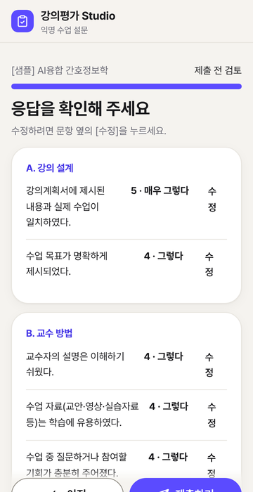
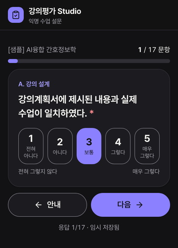

# 강의평가 Studio

간호학과 교수가 학기말에 **교과목별 강의평가를 직접 운영**하는 웹 앱입니다.
Google 스프레드시트 하나와 Apps Script만으로 동작하며 외부 서버가 필요 없습니다.

> ⚠️ **이 도구는 학교 공식 강의평가를 대체하지 않습니다.** 교수자가 수업 개선(CQI)을 위해 자율적으로 운영하는 형성평가용 설문 도구입니다.

| 학생 화면(모바일) | 검토 화면 | 다크 모드 |
|---|---|---|
|  |  |  |

| 교수 대시보드 | 결과 분석 |
|---|---|
|  |  |

---

## 주요 기능

**학생 화면**
- 로그인 없이 응답합니다. 학번·이름·이메일·IP·기기 정보를 수집하지 않으며, 제출 **날짜만** 기록합니다.
- 기본 15문항에 CLO 문항이 더해진 약 3분 분량입니다. 휴대폰에서는 한 화면에 한 문항, PC에서는 영역 단위로 표시됩니다.
- 큰 버튼(48px 이상)으로 응답하고 키보드 숫자 1~5로도 고를 수 있습니다. 진행 바와 임시 저장을 지원합니다.
- 제출 전에 검토 화면을 거치며, 제출하면 감사 화면이 나타납니다.
- 기간 전 접속·마감·토큰 재사용 시 각각 안내 화면을 보여 줍니다.

**교수 화면**
- 대시보드: 진행 중인 교과목, 응답률, 전체 평균, 마감 임박 알림을 보여 줍니다.
- 교과목 관리: 생성, 이전 학기 복제, 응답 기간 설정, 링크·QR 생성, 수업 화면용 QR 크게 띄우기를 지원합니다.
- 일회용 토큰: N개를 생성하고 A4 절취형 인쇄 시트로 출력합니다. 시트의 QR을 찍으면 토큰이 자동 입력됩니다.
- 문항 편집기: 기본 문항 불러오기, 드래그(또는 ↑↓ 버튼)로 순서 변경, CLO 일괄 입력을 지원합니다.
- 결과 분석: 문항별 평균·표준편차·분포, 영역 레이더 차트, 학기 간·분반 간 비교, 서술형 응답(무작위 순서)을 제공합니다.
- 내보내기: 원자료 CSV, CQI 요약표, 서술형 전체 텍스트(AI 요약용 안내문 포함)를 내려받을 수 있습니다.
- **응답이 최소 공개 수(기본 5명) 미만이면 결과를 잠급니다.** 결과공개일을 지정하면 그 이전에도 잠깁니다(성적 처리 전 열람 방지).

---

## 설치 가이드 (교수용 · 약 15분)

미리 준비할 것: Google 계정 하나(개인 Gmail 권장. 아래 [문제 해결](#문제-해결) 참고)

### 1단계. 템플릿 사본 만들기 (1분)

1. 배포자에게 받은 **템플릿 링크**를 엽니다. 링크 끝이 `/copy`이면 사본 만들기 창이 바로 열립니다.
2. **[사본 만들기]** 를 누릅니다. 내 Google Drive에 *강의평가 Studio의 사본*이 생깁니다.

> 📷 *스크린샷 자리: 「문서 사본 만들기」 대화상자*

사본 안에는 프로그램(Apps Script)도 함께 복사됩니다. 이 사본은 **나만의 독립된 강의평가 시스템**이 됩니다.

### 2단계. 초기 설정 실행 (2분)

1. 사본 스프레드시트를 열고 5~10초 기다리면 상단 메뉴에 **[강의평가 Studio]** 가 나타납니다.
2. **[강의평가 Studio] ▸ ① 초기 설정 실행** 을 누릅니다.

> 📷 *스크린샷 자리: 상단 메뉴 [강의평가 Studio] 펼친 모습*

초기 설정이 끝나면 다음이 자동으로 만들어집니다.

| 탭 | 내용 |
|---|---|
| Settings | 교수명, 소속, 최소 공개 응답 수(5), PIN 해시 등 |
| Courses | 샘플 교과목 1개 `[샘플] AI융합 간호정보학` |
| Items | 공통 기본 문항 15개, 샘플 교과목 문항 17개(CLO 2개 포함) |
| Tokens | 일회용 토큰 해시(원문 토큰은 저장하지 않음) |
| Responses | 응답(날짜만 기록, 시각 미저장) |

Responses와 Tokens 탭에는 직접 편집하면 경고가 뜨도록 보호가 걸려 있습니다.

### 3단계. 권한 승인 (2분)

처음 실행하면 Google이 권한을 묻습니다. 개인이 만든 스크립트에는 항상 나타나는 정상 절차입니다.

1. **[계속]** → 내 계정을 선택합니다.
2. 「Google에서 확인하지 않은 앱」 화면이 나오면 **[고급] ▸ [강의평가 Studio(으)로 이동(안전하지 않음)]** 을 누릅니다.
3. 요청 권한을 확인하고 **[허용]** 을 누릅니다.

> 📷 *스크린샷 자리: 「Google에서 확인하지 않은 앱」 화면과 [고급] 위치*

요청하는 권한은 다음 두 가지뿐입니다.
- **이 스프레드시트만** 보고 편집: `@OnlyCurrentDoc` 설정으로 다른 파일에는 접근하지 않습니다.
- 스프레드시트에 메뉴·대화상자 표시

승인한 뒤 **① 초기 설정 실행**을 한 번 더 누르면 설정이 완료됩니다.

### 4단계. 웹 앱으로 배포 (5분)

1. **[확장 프로그램] ▸ [Apps Script]** 를 엽니다.
2. 오른쪽 위 **[배포] ▸ [새 배포]** 를 누릅니다.
3. 톱니바퀴(유형 선택)에서 **웹 앱**을 고릅니다.
4. 다음과 같이 설정합니다. **이 설정이 가장 중요합니다.**
   - 설명: `강의평가 Studio`
   - **다음 사용자 인증 정보로 실행: 나(내 이메일)**
   - **액세스 권한이 있는 사용자: 모든 사용자** ← 학생이 로그인 없이 응답하려면 반드시 이 값이어야 합니다.
5. **[배포]** 를 누르고 표시되는 **웹 앱 URL**(`https://script.google.com/macros/s/…/exec`)을 복사합니다.

> 📷 *스크린샷 자리: 「새 배포」 창의 웹 앱 설정(실행 사용자·액세스 권한)*

나중에 스프레드시트 메뉴 **[웹 앱 주소 확인]** 에서도 이 주소를 볼 수 있습니다.

### 5단계. 관리자 PIN 설정 후 로그인 (2분)

1. 스프레드시트 메뉴 **[강의평가 Studio] ▸ ② 관리자 PIN 설정·재설정** 을 누릅니다.
2. 숫자 6~12자리 PIN을 두 번 입력합니다.
3. 브라우저에서 `웹앱URL?page=admin` 으로 접속해 PIN으로 로그인합니다. 이 주소는 즐겨찾기에 추가해 두세요.
4. **[설정]** 탭에서 **교수명·소속**을 입력합니다. 모든 화면 하단에 표시됩니다.

> 📷 *스크린샷 자리: 교수자 로그인 화면 → 대시보드*

**PIN을 잊었다면** 같은 메뉴 ②에서 다시 설정하면 됩니다. 스프레드시트 소유자만 할 수 있으며, 다시 설정하면 PIN 잠금과 기존 로그인도 함께 해제됩니다.

---

## 첫 강의평가 운영하기

1. **[교과목] ▸ [새 교과목]**: 교과목명·학년도·학기·분반·수강인원·응답 기간을 입력합니다. 공통 기본 문항은 자동으로 복사됩니다.
2. **[문항] ▸ CLO 일괄 입력**: 학습성과를 한 줄에 하나씩 입력하면 "나는 ~할 수 있게 되었다." 문항으로 바뀌어 영역 D에 들어갑니다.
3. 참여 방식을 고릅니다.
   - **접속코드**(간편): **[링크·QR] ▸ [수업 화면에 띄우기]** 로 QR과 코드를 보여 줍니다.
   - **일회용 토큰**(1인 1회 보장): **[토큰]** 으로 수강인원보다 2~3개 넉넉하게 생성 → A4 인쇄 → 잘라서 **무작위로 섞어** 나눠 줍니다.
4. 응답이 최소 공개 수(기본 5명)를 넘으면 **[결과]** 에서 분석과 내보내기를 할 수 있습니다.
5. 다음 학기에는 **[복제]** 로 문항을 그대로 가져옵니다. 학기 간 비교는 **같은 교과목명·같은 분반**끼리 자동으로 이루어집니다.


> **응답이 들어온 뒤에는 그 교과목의 문항을 수정할 수 없습니다.** 문항이 바뀌면 기존 응답과 의미가 달라지기 때문입니다. 응답을 받기 전에 문항을 확정하세요.

---

## 🧪 테스트용 샘플 응답 (실제 운영 전 반드시 삭제)

- **[강의평가 Studio] ▸ [테스트] 샘플 응답 30건 생성**: 샘플 교과목에 가상 응답 30건을 만들어 결과 화면을 미리 볼 수 있습니다.
- **[강의평가 Studio] ▸ [테스트] 샘플 데이터 모두 삭제**: 샘플 응답(`SAMPLE-`로 시작)과 샘플 교과목(`demo`로 시작)의 문항·토큰·응답을 모두 지웁니다.

> ⚠️ **학생에게 링크를 배포하기 전에 반드시 샘플 데이터를 삭제하세요.** 샘플 응답이 남아 있으면 통계가 왜곡됩니다.

---

## 익명성·보안 설계와 한계

| 항목 | 처리 방식 |
|---|---|
| 개인정보 | 학번·이름·이메일·IP·User-Agent를 수집하지 않음. 응답 행에는 UUID·교과목 ID·제출 날짜·문항 응답만 저장 |
| 응답 시각 | 시각은 저장하지 않고 날짜만 기록. 응답 행은 **무작위 위치에 삽입**해 행 순서로 제출 순서를 추정하기 어렵게 함 |
| 결과 공개 | 응답 수가 최소 공개 수 미만이면 결과·내보내기·분반 비교·서술형을 모두 잠금(소규모 집단 보호) |
| 서술형 | 볼 때마다 무작위 순서로 표시 |
| 토큰 | SHA-256 + salt 해시만 저장. 원문 토큰은 생성 직후 인쇄·내려받기용으로 한 번만 표시 |
| 동시 제출 | LockService로 토큰 검증 → 사용 처리 → 응답 기록을 원자적으로 처리. 잠금 대기 초과 시 클라이언트가 지수 백오프로 재시도(최대 4회). nonce로 중복 기록 방지 |
| 입력 검증 | 서버에서 길이 제한(서술형 1,000자)·허용값 검증. `=`·`+`·`-`·`@`로 시작하는 값은 앞에 `'`를 붙이고, 학생 입력은 항상 텍스트 셀로 저장(수식 주입·자동 형변환 차단). HTML 이스케이프는 화면 출력 시점에 적용 |
| 관리자 | PIN은 SHA-256 + salt 해시로 저장. 5회 실패 시 10분 잠금. 로그인 세션은 6시간 |

**알고 계셔야 할 한계(사실대로 밝힙니다)**
1. **Google 스프레드시트의 「버전 기록」에는 편집 시각이 남습니다.** 앱이 시각을 저장하지 않더라도 소유자는 버전 기록에서 대략적인 제출 시각을 볼 수 있습니다. 그래서 학생 안내 문구는 "추적할 수 없다"가 아니라 "제출 시각을 **따로 저장하지 않는다**"로 정확히 표현했습니다.
2. **접속코드 방식은 같은 학생의 중복 응답을 완전히 막지 못합니다.** 같은 기기에서는 "이미 제출한 기록이 있다"는 안내만 표시합니다. 1인 1회가 중요하면 토큰 방식을 쓰세요.
3. **토큰을 학생 명단 순서대로 나눠 주면** 익명성이 약해질 수 있습니다. 반드시 섞어서 나눠 주세요.
4. **PIN 잠금은 계정 전체에 적용됩니다.** IP를 수집하지 않기 때문에, 누군가 틀린 PIN을 5번 입력하면 교수 본인도 10분간 로그인할 수 없습니다. 급하면 메뉴 ②에서 PIN을 다시 설정해 잠금을 즉시 풀 수 있습니다.

---

## 문제 해결

| 증상 | 해결 |
|---|---|
| 배포 화면에 「모든 사용자」가 없음 | 대학 Google Workspace 계정은 관리자 정책으로 익명 접근이 막혀 있을 수 있습니다. 개인 Gmail 계정으로 사본을 만들어 배포하거나, 학교 IT 관리자에게 문의하세요. |
| 학생이 Google 로그인 화면을 봄 | 배포 설정의 액세스 권한이 「모든 사용자」인지 확인하세요. 설정을 바꿨다면 **[배포 관리] ▸ 편집 ▸ 새 버전**으로 다시 배포해야 합니다. |
| 코드를 고쳤는데 반영되지 않음 | Apps Script는 배포한 **버전**을 실행합니다. **[배포] ▸ [배포 관리] ▸ ✏️ ▸ 버전: 새 버전 ▸ [배포]** 를 하면 URL은 그대로 두고 내용만 바뀝니다. |
| 「설문 준비 중입니다」 안내가 나옴 | 메뉴 ① 초기 설정 실행을 먼저 하세요. |
| 토큰 인쇄 창이 열리지 않음 | [인쇄용 파일(HTML)]을 내려받아 열면 인쇄 창이 바로 뜹니다. |
| 내려받기가 막힘 | 복사 창이 대신 열립니다. 내용을 복사해 메모장·엑셀에 붙여 넣으세요. |

---

## 템플릿 제작자용 (최초 1회)

배포할 템플릿 시트는 다음과 같이 만듭니다.

1. 새 Google 스프레드시트를 만들고 이름을 `강의평가 Studio`로 바꿉니다.
2. **[확장 프로그램] ▸ [Apps Script]** 를 엽니다. 편집기 **설정(⚙)** 에서 **「편집기에서 'appsscript.json' 매니페스트 파일 표시」** 를 켭니다.
3. 이 저장소의 파일을 같은 이름으로 만들고 내용을 붙여 넣습니다.
   - 스크립트 파일: `Code.gs`, `Setup.gs`
   - HTML 파일: `Index`, `Admin`, `Styles`, `Scripts` (확장자 `.html`은 자동으로 붙습니다)
   - `appsscript.json`은 기존 내용을 바꿔 씁니다.
   - [clasp](https://github.com/google/clasp)를 쓴다면 `clasp push` 한 번으로 됩니다. `.claspignore`가 테스트 파일을 제외합니다.
4. 시트를 공유 설정 「링크가 있는 모든 사용자: 뷰어」로 바꾸고, URL의 `/edit…` 부분을 `/copy`로 바꿔 교수들에게 배포합니다.

> 템플릿 시트에서는 **setup을 실행하지 않은 상태**로 배포하는 것이 좋습니다. 각 교수의 사본에서 setup이 실행되면서 고유한 토큰 salt가 만들어집니다.

### 파일 구성

| 파일 | 역할 |
|---|---|
| `Code.gs` | 웹 앱 진입점(`doGet`), 학생·교수 API, 통계 계산, 보안(잠금·해시·검증) |
| `Setup.gs` | `setup()`, 스프레드시트 메뉴, 기본 문항 은행, 샘플 응답 생성·삭제 |
| `Index.html` | 학생 화면 (`?c=교과목ID`) |
| `Admin.html` | 교수 화면 (`?page=admin`) |
| `Styles.html` | 디자인 시스템 *Cloud Dancer Bento* (라이트/다크 토큰) |
| `Scripts.html` | 공통 JS: 서버 호출(재시도·로딩), 모달, 다운로드, 내장 QR 인코더, confetti |
| `appsscript.json` | V8, Asia/Seoul, 웹 앱(실행: 소유자 / 액세스: 모든 사용자) |
| `tests/` | 로컬 테스트(Apps Script에는 올리지 않음) |

외부 리소스는 jsDelivr의 **Pretendard Variable 1.3.9, Lucide 0.460.0, Chart.js 4.4.1** 세 가지만 사용합니다. QR 코드는 외부 라이브러리 없이 `Scripts.html`에 내장한 인코더로 만듭니다.

---

## 개발자용: 로컬 테스트

Apps Script 서비스(SpreadsheetApp·LockService·CacheService·HtmlService)를 흉내 낸 모의 환경에서 실제 `Code.gs`/`Setup.gs`를 그대로 실행합니다.

```bash
cd tests
npm install          # chart.js, lucide, pretendard, jsqr (테스트 전용)
npm test             # 전체 실행(Playwright Chromium 필요)
node preview-server.js 8787   # 브라우저 미리보기: http://127.0.0.1:8787/exec?scenario=student
```

| 테스트 | 내용 |
|---|---|
| `server.test.js` | setup, PIN 해시·잠금, 세션, 입력 검증·수식 주입, 기간 외 접속, 토큰 1회성·nonce 멱등, 최소 응답 수 잠금, 결과공개일, 역문항, 내보내기, 문항 잠금·복제, 샘플 생성·삭제, doGet 이스케이프 |
| `concurrency.test.js` | worker_threads로 **실제 병렬** 동시 제출 20건(토큰·접속코드), 같은 토큰 동시 20건 → 1건만 성공, 잠금 해제 대조군 |
| `qr.test.js` | 내장 QR 인코더 출력을 jsQR로 디코딩해 원문과 일치하는지 확인 |
| `contrast.test.js` | 라이트·다크 토큰의 WCAG 2.2 AA 대비 |
| `ui.test.js` | Playwright: 360px 학생 전체 흐름, 임시 저장 복원, 네트워크 실패 후 재시도, 안내 화면, 다크 모드·모션 최소화, 교수 화면(360px·데스크톱) |

**모의 환경의 한계**: 실제 Google 서버의 동시 실행 한도(사용자당 약 30건)와 Sheets 지연 시간은 재현하지 못합니다. 배포 후에는 학생 몇 명과 함께 동시에 제출해 보는 실사용 점검을 권장합니다.

---

Developed by 정종필 교수 · 청암대학교 간호학과
